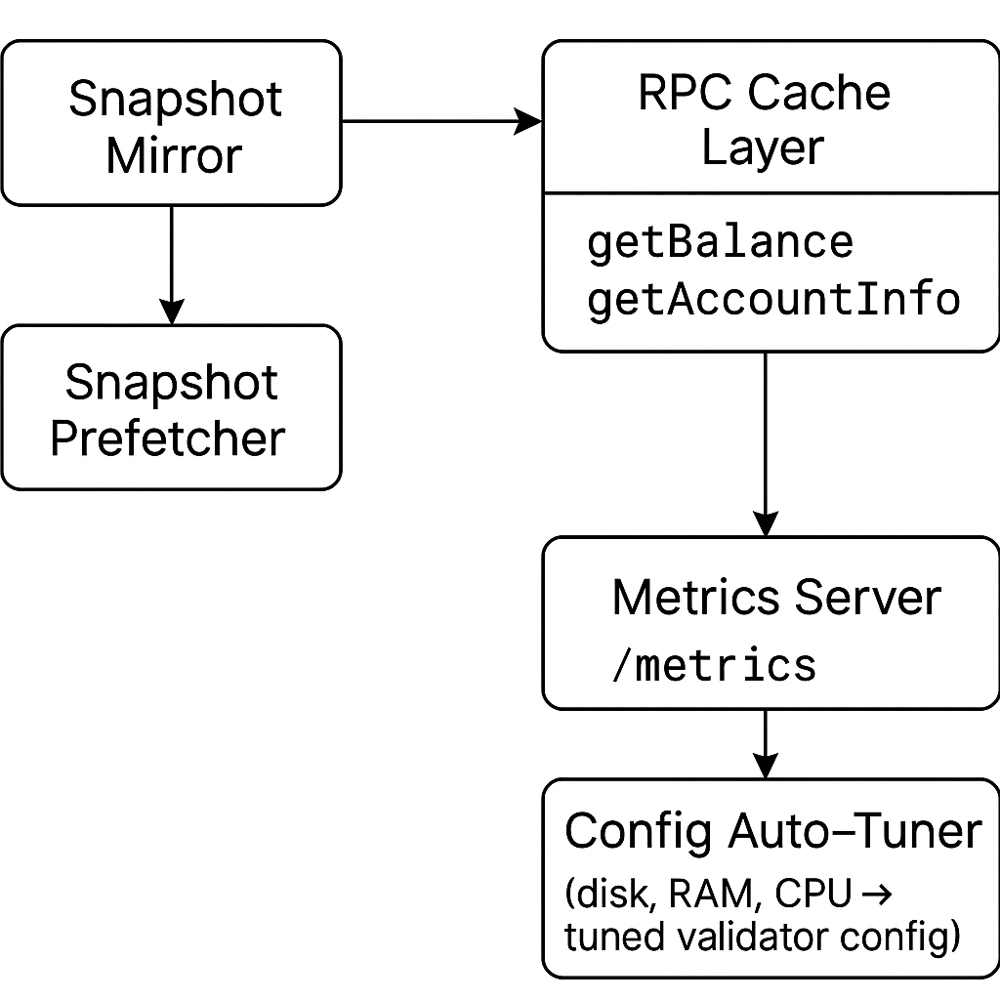

# solana-validator-optimizer

[](https://crates.io/crates/solana-validator-optimizer)
[](https://github.com/0rlych1kk4/solana-validator-optimizer/releases)
[](https://docs.rs/solana-validator-optimizer)

> A production-grade Rust toolkit for Solana infrastructure diagnostics, validator optimization, RPC health checks, caching, metrics, and production-readiness workflows.
---

## Overview

`solana-validator-optimizer` is a modular enhancement suite for Solana validator infrastructure. It helps operators by:

- Running validator preflight readiness checks before deployment or restart
- Validating RPC health, cluster genesis hash, current slot, and blockhash availability
- Checking host CPU, memory, and disk readiness
- Prefetching ledger snapshots from trusted mirrors
- Validating snapshot integrity via SHA-256
- Auto-tuning validator configuration based on hardware resources
- Adding an in-memory LRU cache for frequently used RPC calls
- Exposing Prometheus metrics via a `/metrics` endpoint

---

## Compatibility

The project currently builds against the **Solana 3.x Rust crate line**.

- Solana crate line: **3.x**
- RPC diagnostics have been exercised against Mainnet-Beta RPC endpoints reporting **Agave/Solana 4.x**
- Tested against:
  - Mainnet RPC: https://api.mainnet-beta.solana.com
  - `solana-test-validator` (local)

> RPC-level interoperability with a newer Agave endpoint does not imply full build-time compatibility with the Agave 4.x Rust crate line.

---

## Ideal For

- Solana Validator Operators  
- RPC Infrastructure Maintainers  
- Performance-Focused Mainnet/Devnet Deployments  

---

## Core Features

| Feature | Description |
| --- | --- |
| Validator Preflight | Aggregates RPC, cluster identity, CPU, memory, disk, and readiness checks into PASS/WARN/FAIL results |
| Genesis Validation | Retrieves the cluster genesis hash and optionally validates it against an operator-supplied expected hash |
| Snapshot Prefetching | Downloads or copies snapshots locally with optional SHA-256 validation |
| RPC LRU Cache | Reduces redundant RPC calls like `getBalance`, `getEpochInfo`, etc. |
| Prometheus Metrics | `/metrics` endpoint for cache hits, misses, request counts, and latency |
| Config Auto-Tuner | Adjusts validator configuration based on CPU, RAM, disk, and network |
| RPC Health Checker | Checks RPC health, Solana/Agave version, genesis hash, current slot, latest blockhash availability, and RPC latency |

---

## Architecture



---

## Getting Started

### 1. Clone the Repository

```bash
git clone https://github.com/0rlych1kk4/solana-validator-optimizer.git
cd solana-validator-optimizer
```

---

### 2. Configuration

Create a `Config.toml` file in the project root:

```toml
# Config.toml

# Snapshot settings
snapshot_url   = ""    # e.g. "https://snapshots.myvalidator.com/latest.tar.zst"
snapshot_sha256 = ""   # optional SHA-256 checksum for validation

# RPC and Metrics
rpc_url      = "https://api.mainnet-beta.solana.com"
metrics_port = 9090    # Prometheus scrapes at http://<host>:9090/metrics

# Cache settings
cache_size = 128       # Number of entries in the RPC LRU cache
```

---

## Usage – CLI Mode

Run all modules (snapshot, RPC cache, auto-tuner, metrics):

```bash
cargo run -p solana-validator-optimizer-cli --release
```

---

## Usage – As a Library

Add this to your `Cargo.toml`:

```toml
[dependencies]
solana-validator-optimizer = "2.2.1"
tokio = { version = "1", features = ["full"] }
anyhow = "1"
```

Example usage:

```rust
use solana_validator_optimizer::{
    config::AppConfig,
    snapshot_prefetcher,
    rpc_cache_layer,
    metrics,
    config_autotuner,
};

#[tokio::main]
async fn main() -> anyhow::Result<()> {
    // Load configuration from Config.toml and/or OPTIMIZER_* env vars
    let cfg = AppConfig::load()?;

    // Prefetch snapshot (no-op if snapshot_url is empty)
    snapshot_prefetcher::run(&cfg).await?;

    // Auto-tune configuration (currently informational)
    config_autotuner::autotune_config(&cfg).await?;

    // Start background RPC cache workers
    rpc_cache_layer::start_rpc_cache(&cfg).await?;

    // Start Prometheus metrics server (blocks)
    metrics::start_metrics_server(&cfg).await?;

    Ok(())
}
```

---
## Usage – RPC Health Checker

Check the configured Solana RPC endpoint from `Config.toml`:

```bash
cargo run -p solana-validator-optimizer-cli -- rpc-health
```

Example output:

```text
Solana RPC Health Report
Endpoint: https://api.mainnet-beta.solana.com
Healthy: true
Health Status: ok
Solana Version: 4.2.0-rc.1
Genesis Hash: 5eykt4UsFv8P8NJdTREpY1vzqKqZKvdpKuc147dw2N9d
Current Slot: 438204077
Latest Blockhash: 77L8S6DcWGDsAVQJr1S4n4n7EPn7wP365DgHiMNFJbMc
getHealth Latency: 956 ms
getVersion Latency: 328 ms
getGenesisHash Latency: 308 ms
getSlot Latency: 295 ms
getLatestBlockhash Latency: 626 ms
```

Use a custom endpoint:

```bash
cargo run -p solana-validator-optimizer-cli -- rpc-health --endpoint https://api.mainnet-beta.solana.com
```

Output as JSON:

```bash
cargo run -p solana-validator-optimizer-cli -- rpc-health --json
```

The RPC Health Checker helps Solana infrastructure teams validate endpoint health, cluster identity, blockhash availability, and latency before transaction submission or production deployment.

---

## Usage – Validator Preflight

Run production-readiness checks using the RPC endpoint configured in `Config.toml`:

```bash
cargo run -p solana-validator-optimizer-cli -- preflight
```

The preflight command evaluates:

- RPC health
- Solana/Agave version
- Cluster genesis hash
- Current slot
- Latest blockhash availability
- RPC latency
- Logical CPU count
- Total memory
- Available memory
- Available disk space

Example output:

```text
Solana Validator Preflight
Endpoint: https://api.mainnet-beta.solana.com

[PASS] rpc_health           RPC health status: ok
[PASS] solana_version       Detected Solana/Agave version: 4.2.0-rc.1
[PASS] genesis_hash         Genesis hash: 5eykt4UsFv8P8NJdTREpY1vzqKqZKvdpKuc147dw2N9d
[PASS] current_slot         Current slot: 438203915
[PASS] latest_blockhash     Latest blockhash available
[PASS] rpc_latency          RPC latency is within the 1000 ms threshold
[PASS] cpu                  Logical CPU count: 8
[WARN] memory_total         Total memory: 8.0 GiB
[WARN] memory_available     Available memory: 0.34 GiB
[PASS] disk_available       Disk space: 57.8 GiB available / 228.3 GiB total

Overall readiness: READY
```

### Validate an Expected Genesis Hash

Use an expected genesis hash to detect a wrong-cluster configuration:

```bash
cargo run -p solana-validator-optimizer-cli -- preflight --expected-genesis-hash 5eykt4UsFv8P8NJdTREpY1vzqKqZKvdpKuc147dw2N9d
```

A matching hash produces:

```text
[PASS] genesis_hash         Genesis hash matches expected value: 5eykt4UsFv8P8NJdTREpY1vzqKqZKvdpKuc147dw2N9d
Overall readiness: READY
```

A mismatch is treated as a hard readiness failure:

```text
[FAIL] genesis_hash         Genesis hash mismatch: expected 11111111111111111111111111111111, observed 5eykt4UsFv8P8NJdTREpY1vzqKqZKvdpKuc147dw2N9d
Overall readiness: NOT READY
```

Warnings such as elevated RPC latency or limited available memory do not automatically fail readiness. Hard failures such as an unhealthy RPC endpoint, missing required cluster data, or a genesis-hash mismatch result in `NOT READY`.

Machine-readable output is also available:

```bash
cargo run -p solana-validator-optimizer-cli -- preflight --json
```

---
## Environment Variables

Any Config.toml value can be overridden using the OPTIMIZER_ prefix.

| Config Key       | Environment Variable        |
|------------------|-----------------------------|
| snapshot_url     | `OPTIMIZER_SNAPSHOT_URL`    |
| snapshot_sha256  | `OPTIMIZER_SNAPSHOT_SHA256` |
| rpc_url          | `OPTIMIZER_RPC_URL`         |
| metrics_port     | `OPTIMIZER_METRICS_PORT`    |
| cache_size       | `OPTIMIZER_CACHE_SIZE`      |

**Example:**

```bash
OPTIMIZER_RPC_URL=https://api.mainnet-beta.solana.com \
OPTIMIZER_CACHE_SIZE=256 \
cargo run --release
```
---
## Operational Metrics
Prometheus endpoint:
```bash
http://<host>:<metrics_port>/metrics
```
### Exposed Metrics

- `rpc_requests_total`
- `rpc_cache_hits_total`
- `rpc_cache_misses_total`

### Metrics
Enable Prometheus metrics endpoint:
```bash
cargo run -p solana-validator-optimizer-cli --release --features metrics -- --config Config.toml run
curl -s http://127.0.0.1:9090/metrics | grep rpc_
```
---
## Contributing

Contributions are welcome!  
Feel free to open issues, feature requests, or pull requests.

---

## License

Licensed under the **MIT License**.
